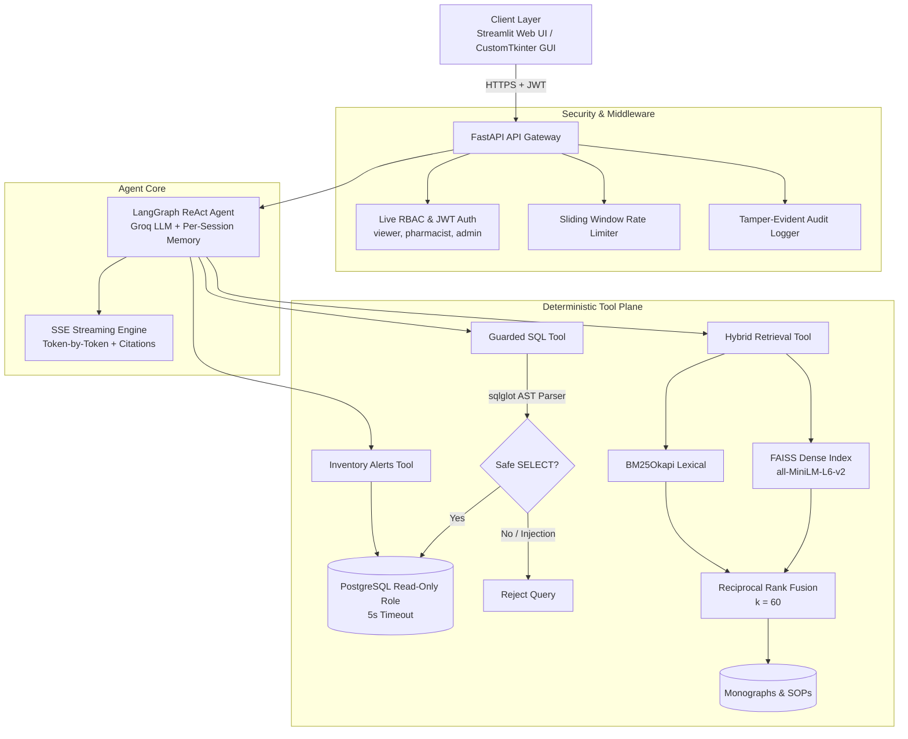

# 💊 Pharma AI Agent: Conversational Assistant for Pharmacy Operations

[](https://github.com/OWNER/REPO/actions/workflows/ci.yml)
[](https://www.python.org/)
[](https://fastapi.tiangolo.com)
[](https://langchain-ai.github.io/langgraph/)
[-brightgreen.svg)](docs/evidence/coverage_term.txt)
[](docs/METRICS.md)

An enterprise-grade conversational assistant that unifies **live PostgreSQL inventory** with **unstructured regulatory documentation** (FDA package inserts, storage guidelines, SOPs). Staff ask questions in natural language; the agent returns answers backed by **verifiable citations** (executed SQL with row counts, or document name and page number), all behind deterministic safety guardrails.

> **Clinical Disclaimer:** *The bundled FDA monographs and guidelines are sample demonstration data. The assistant provides operational insights and decision support only and is not a substitute for the clinical judgment of a licensed pharmacist or physician.*

---

## 📌 Table of Contents
- [Why This Project](#-why-this-project)
- [System Architecture](#-system-architecture)
- [Key Features](#-key-features)
- [Technical Deep Dive](#-technical-deep-dive)
  - [Agent Execution Loop](#agent-execution-loop)
  - [Hybrid Retrieval Pipeline](#hybrid-retrieval-pipeline)
  - [SQL Guardrail Pipeline](#sql-guardrail-pipeline)
- [Benchmark Metrics & Verification](#-benchmark-metrics--verification)
- [Security & Defense-in-Depth](#-security--defense-in-depth)
- [Getting Started](#-getting-started)
  - [Option A: Docker Compose (Recommended)](#option-a-docker-compose-recommended)
  - [Option B: Local Virtual Environment](#option-b-local-virtual-environment)
- [API Reference & Streaming Events](#-api-reference--streaming-events)
- [Testing & Quality Assurance](#-testing--quality-assurance)
- [CI/CD & Deployment](#-cicd--deployment)
- [Project Structure](#-project-structure)

---

## 🎯 Why This Project

Pharmacy staff constantly switch between relational inventory tools and dense PDF documentation: *"Which batches expire next month?"*, *"How must Amoxicillin be reconstituted and stored?"* Under time pressure, a misread expiry date, a missed cold-chain requirement (2 °C to 8 °C), or a near-expiry batch dispensed by mistake threatens patient safety and invites regulatory trouble. Off-the-shelf LLMs can't be trusted here without verified retrieval and provenance.

This project bridges the gap with a single conversational layer built on three principles:

1. **Zero Hallucination Tolerance:** The agent must cite the executed SQL query or the exact document page. If the data is absent, it says so instead of guessing.
2. **Deterministic Guardrails:** The LLM cannot mutate database state. Stock adjustments require an authenticated two-step confirmation flow with FEFO verification.
3. **Defense-in-Depth SQL Security:** Generated queries are parsed into an Abstract Syntax Tree (AST) with `sqlglot` and rejected if they contain DDL/DML, stacked statements, comments, or non-whitelisted tables, before anything reaches the database.

---

## 🏗 System Architecture



---

## ✨ Key Features

* **LangGraph ReAct Orchestrator:** Multi-step autonomous agent on Groq inference, with isolated `MemorySaver` checkpointing keyed by `(username, session_id)`.
* **Verifiable Citations:** Every answer carries machine-readable provenance: SQL queries with row counts, or file name, page, and chunk ID for documents.
* **Server-Sent Events (SSE) Streaming:** Real-time token streaming with live tool-call and citation events.
* **Hybrid Knowledge Retrieval (Dense + Sparse):**
  * Dense search over 384-dimensional embeddings (`sentence-transformers/all-MiniLM-L6-v2`) in FAISS.
  * BM25Okapi for exact alphanumeric matches (eGFR thresholds, batch codes, acronyms).
  * Reciprocal Rank Fusion (RRF, $k=60$) to combine semantic and lexical rankings.
* **Human-in-the-Loop Stock Operations:** Two-step stock in/out flow with ephemeral confirmation tokens, FEFO order warnings, and audit logging.
* **Proactive Inventory Alerts:** Critical low-stock and near-expiry batch detection, available to both the agent and the API.
* **Dual UI Interfaces:**
  * Responsive **Streamlit Web Dashboard** with live chat, inventory monitoring, document explorer, and audit viewer.
  * Dark-themed **CustomTkinter Desktop Client** (`gui.py`) for local workstations.

---

## 🔬 Technical Deep Dive

### Agent Execution Loop

* **State graph:** Built with LangGraph's `create_react_agent`, managing message history, tool dispatch iterations, and system-instruction constraints.
* **Context management:** `trim_messages` with token boundaries keeps long multi-turn sessions inside the context window.
* **Per-user isolation:** `MemorySaver` is keyed on `(username, session_id)`, preventing cross-user session leakage.
* **Tools available to the agent:**

| Tool | Purpose |
|---|---|
| `check_inventory_sql` | Live batch quantities, expiry dates, supplier metadata, and stock movement history (guarded, read-only) |
| `search_guidelines` | Storage rules, boxed warnings, reconstitution instructions, contraindications from ingested documents |
| `get_inventory_alerts` | Near-expiry batches and below-threshold stock pulled into the agent's context |

### Hybrid Retrieval Pipeline

Clinical queries pose two different challenges: **exact terminology** (`eGFR < 30 mL/min`, `CYP2C19`, batch codes) where dense embeddings lose keyword precision, and **colloquial phrasing** (*"swollen ankles"* → *peripheral edema*) that needs semantic matching. The pipeline runs both retrievers and fuses them:

```
Query ─┬─► Dense  (FAISS / all-MiniLM-L6-v2) ─► Top-K dense  ─┐
       │                                                      ├─► RRF (k=60) ─► Top-K passages
       └─► Sparse (BM25Okapi)                ─► Top-K sparse ─┘
```

$$RRF(d) = \sum_{m \in \{dense,\,sparse\}} \frac{1}{k + r_m(d)} \qquad (k = 60)$$

RRF merges rankings rather than raw scores, so no score calibration between retrievers is required.

* **Dense layer:** `all-MiniLM-L6-v2` (384-d) with a FAISS Flat L2 index and companion metadata files.
* **Sparse layer:** BM25Okapi (`rank-bm25`) over alphanumeric tokens from the ingestion pipeline.
* **Ingestion:** PDF, Markdown, and TXT. Recursive character splitting (`chunk_size=800`, `overlap=100`) preserves provenance (`source`, `page_number`, `chunk_id`).

### SQL Guardrail Pipeline

```
Agent-generated SQL
   │
   ├─ sqlglot parse (PostgreSQL dialect), exactly 1 statement ──► else REJECT
   ├─ Root node must be Select / Union ───────────────────────► else REJECT
   ├─ AST walk: no Insert/Update/Delete/Drop/Create/Alter/
   │            Command/Merge/Copy/Into/Lock ─────────────────► else REJECT
   ├─ Function allow-list (no Anonymous: pg_sleep, dblink,
   │            query_to_xml, ...) ───────────────────────────► else REJECT
   ├─ Table allow-list: medicines, batches, inventory_logs
   │            (schema-qualified refs like pg_catalog.* rejected) ► else REJECT
   ▼
 Execution sandbox
   ├─ Read-only transaction (SET TRANSACTION READ ONLY)
   ├─ 5-second statement timeout
   └─ Dedicated Postgres role: SELECT only on allow-listed tables
```

---

## 📊 Benchmark Metrics & Verification

Evaluated on **66 clinical queries** over **11 FDA drug monographs** (e.g., Amoxicillin, Metformin, Lisinopril, Atorvastatin), split between exact clinical phrasing and paraphrased colloquial terms, on a standardized test harness.

### Retrieval Performance: Dense vs. Sparse vs. Hybrid RRF

| Retrieval Method | Hit@1 | Hit@3 | Hit@5 (Recall) | MRR |
|:---|:---:|:---:|:---:|:---:|
| **Dense Only** (FAISS, `all-MiniLM-L6-v2`) | 84.9% | 95.5% | 98.5% | 0.9051 |
| **Sparse Only** (BM25Okapi) | 69.7% | 89.4% | 98.5% | 0.8091 |
| **Hybrid** (RRF, $k=60$) | **84.9%** | **98.5%** *(+3.0 pts vs. dense)* | **100.0%** *(+1.5 pts)* | **0.9129** *(+0.0078)* |

> **Key Takeaway:** Hybrid RRF reached **100% Hit@5** on the evaluation set. BM25 surfaced exact numeric and alphanumeric matches (`eGFR < 30`, `20 to 25 degrees C`), while dense retrieval covered symptom-style paraphrases; fusion kept the best of both.

### End-to-End Latency

Measured against a live PostgreSQL instance, real embedding models, and live LLM API calls.

| Scenario | Route | Concurrency | p50 | p95 | Errors / 429 |
|---|---|:---:|---:|---:|:---:|
| Knowledge base search | `GET /api/v1/documents/search` | 3 | 151.11 ms | 242.37 ms | 0.0% |
| SQL tool, end to end | `POST /api/v1/chat` (inventory query) | 2 | 2,826.12 ms | 5,080.43 ms | 0.0% |
| Document RAG, end to end | `POST /api/v1/chat` (guideline query) | 2 | 14,100.86 ms | 14,819.30 ms | 0.0% |
| Streaming | `POST /api/v1/chat/stream` | 2 | 12,140.61 ms | 20,545.08 ms | 0.0% |

* **Retrieval is cheap:** local CPU dense + lexical search stays around 151 ms median.
* **LLM dominates chat latency:** inventory questions finish in about 2.8 s; guideline questions take longer because they chain tool calls, inject multiple passages, and synthesize citations. Transient upstream throttling is handled with exponential backoff.

### System Surface
* **Code coverage:** **94%** across 1,031 statements (**90 of 90 tests passing**)
* **API surface:** 19 endpoints (17 business routes + 2 ops probes), 7 DB models

---

## 🔒 Security & Defense-in-Depth

1. **AST-Level SQL Validation (`sqlglot`):**
   * Rejects all comments (`--`, `/*`) to prevent parser-differential attacks.
   * Enforces a single root `SELECT` or `UNION`.
   * Walks the AST to block modifying operations (`INSERT`, `UPDATE`, `DELETE`, `DROP`, `ALTER`, `MERGE`, `COPY`, among others).
   * Whitelists only `medicines`, `batches`, and `inventory_logs`; schema-qualified and system-catalog references are rejected.
   * Blocks unknown functions (e.g., `pg_sleep`, `query_to_xml`).
2. **Database Execution Sandbox:**
   * Separate SQLAlchemy engine pool using restricted credentials (`READONLY_DB_PASSWORD`).
   * Read-only transaction context and a strict 5-second statement timeout.
   * `users` and `audit_logs` are unreachable at the database permission layer, even if the AST checks were bypassed.
3. **Live RBAC Invalidation:**
   * Roles and active status are verified against the database on every request, so revocation is instant rather than waiting for JWT expiry.

   | Role | Capabilities |
   |---|---|
   | `viewer` | Chat, inventory summaries and alerts, guideline search |
   | `pharmacist` | Everything above, plus drafting and confirming stock movements |
   | `admin` | Document lifecycle, user provisioning, audit inspection |
4. **Two-Step Stock Modification:**
   * The LLM can never change stock. A pharmacist drafts a movement (`POST /api/v1/inventory/movements`), receiving an ephemeral token and FEFO warnings, then confirms it (`POST .../{token}/confirm`). Operator identity, batch delta, and timestamp are written to `inventory_logs`.
5. **Tamper-Evident Audit Logging:**
   * Authentication attempts, failed authorizations, admin operations, and stock movements are appended to `audit_logs` with actor ID, client IP, action type, and metadata.
6. **Rate Limiting:**
   * An in-memory sliding-window limiter protects chat and authentication endpoints and returns RFC 7807 problem responses on abuse.

---

## 🚀 Getting Started

### Option A: Docker Compose (Recommended)

1. **Configure environment:**
   ```bash
   cp .env.example .env
   # Edit .env and supply your GROQ_API_KEY
   ```

2. **Launch all services:**
   ```bash
   docker compose up --build
   ```
   * **Streamlit Web UI:** [http://localhost:8501](http://localhost:8501)
   * **API Swagger docs:** [http://localhost:8001/docs](http://localhost:8001/docs) *(host port 8001 when running under Docker)*

3. **Log in:**
   * Use `ADMIN_USERNAME` and `ADMIN_PASSWORD` from your `.env` (default: `admin`). Change the default password for anything beyond a local demo.

---

### Option B: Local Virtual Environment

```bash
# 1. Create and activate a virtual environment
python -m venv .venv
source .venv/bin/activate  # On Windows: .venv\Scripts\Activate.ps1

# 2. Install dependencies
pip install -r requirements.txt -r requirements-dev.txt

# 3. Apply database migrations and seed demo data
alembic upgrade head
python -m scripts.seed_demo_data

# 4. Start the FastAPI backend (Swagger at http://localhost:8000/docs)
uvicorn app.main:app --reload --port 8000

# 5. Start the Streamlit Web UI (in another terminal)
streamlit run web/app.py
```

---

## 📡 API Reference & Streaming Events

The API exposes **19 endpoints** documented via Swagger at `/docs`.

### Key Endpoints

| Method | Endpoint | Minimum Role | Description |
|---|---|:---:|---|
| `POST` | `/api/v1/auth/login` | *Public* | Authenticate and obtain a JWT access token |
| `POST` | `/api/v1/chat` | `viewer` | Synchronous JSON chat request |
| `POST` | `/api/v1/chat/stream` | `viewer` | Real-time Server-Sent Events (SSE) chat stream |
| `GET` | `/api/v1/inventory/alerts` | `viewer` | Critical low-stock and near-expiry batches |
| `POST` | `/api/v1/inventory/movements` | `pharmacist` | Draft a stock movement (returns confirmation token) |
| `POST` | `/api/v1/inventory/movements/{token}/confirm` | `pharmacist` | Commit the movement to the inventory log |
| `GET` | `/api/v1/documents` | `viewer` | List ingested monographs and SOP files |
| `GET` | `/api/v1/documents/search` | `viewer` | Hybrid knowledge-base search |
| `POST` | `/api/v1/documents` | `admin` | Ingest and index new PDF / TXT documents |
| `GET` | `/api/v1/admin/audit` | `admin` | View the tamper-evident audit trail |
| `GET` | `/health`, `/ready` | *Public* | Liveness and readiness probes |

### SSE Event Stream (`/api/v1/chat/stream`)

Events, in the order they typically appear: `session` → `tool_call` → `tool_result` → `token` (repeated) → `citations` → `done`.

```text
event: session
data: {"session_id": "9b1deb4d3b7d4ebf9c3f99cedb9b7750"}

event: tool_call
data: {"tool": "check_inventory_sql", "query": "SELECT ..."}

event: token
data: {"text": "According to the monograph, Amoxicillin "}

event: citations
data: {
  "citations": [
    {
      "type": "document",
      "source": "amoxicillin_fda.pdf",
      "page": 3,
      "snippet": "Reconstituted oral suspension must be refrigerated between 2°C and 8°C."
    }
  ]
}

event: done
data: {"session_id": "9b1deb4d3b7d4ebf9c3f99cedb9b7750"}
```

---

## 🧪 Testing & Quality Assurance

**90 automated pytest tests, 94% coverage across 1,031 statements.**

| Module | Coverage |
|---|:---:|
| `app/models.py`, `app/db.py` | 100% |
| `app/sql_guard.py` | 95% |
| `app/inventory.py` | 94% |
| `app/auth.py` | 92% |
| `app/rag.py` | 92% |
| `app/agent.py` | 88% |

* **Hermetic and deterministic:** Tests run against an ephemeral PostgreSQL instance built via Alembic migrations. Embeddings use deterministic fake encoders and the agent is driven by scripted mock models, so the suite runs offline with no API cost.
* **Safety regression tests:** Explicit assertions that SQL injection payloads are rejected: `UNION SELECT`, stacked statements, malicious CTEs, system-table access, and comment tricks.
* **Run locally:**
  ```bash
  pytest --cov=app --cov-report=term-missing
  ruff check .
  ```

---

## 🚢 CI/CD & Deployment

**Container image**
* Multi-stage build on a lightweight Python base image.
* Runs as an unprivileged `appuser` (non-root), with a `/health` health check and a sanitized `.dockerignore`.

**Continuous Integration** (`.github/workflows/ci.yml`)
* Test matrix on Python 3.10 and 3.12.
* Real `postgres:16-alpine` service container with health checks.
* Lint and format enforcement with `ruff`.
* Full test suite with coverage tracking.
* Docker build verification on pull requests.

**Continuous Delivery** (`.github/workflows/cd.yml`)
* Triggers on merge to the main branch.
* Builds multi-architecture images and pushes them to GitHub Container Registry (`ghcr.io`).
* Migration dispatch and rollout specifications for Render and AWS ECS targets.

---

## 📂 Project Structure

> Key paths only; adjust to match your repository.

```text
.
├── app/
│   ├── main.py            # FastAPI application and routes
│   ├── agent.py           # LangGraph ReAct agent, tools, session memory
│   ├── rag.py             # Hybrid retrieval: FAISS + BM25 + RRF, ingestion
│   ├── sql_guard.py       # sqlglot AST validation for generated SQL
│   ├── inventory.py       # Stock movements, FEFO checks, alerts
│   ├── auth.py            # JWT auth and live RBAC
│   ├── models.py          # SQLAlchemy models
│   └── db.py              # Primary and read-only engine pools
├── web/
│   └── app.py             # Streamlit web dashboard
├── gui.py                 # CustomTkinter desktop client
├── alembic/               # Database migrations
├── scripts/
│   └── seed_demo_data.py  # Demo data seeding
├── tests/                 # pytest suite (90 tests)
├── docs/
│   ├── METRICS.md         # Benchmark methodology and results
│   └── evidence/          # Coverage and benchmark evidence
├── .github/workflows/
│   ├── ci.yml             # Lint, test matrix, Docker build
│   └── cd.yml             # Image publish and deploy
├── Dockerfile
├── docker-compose.yml
├── requirements.txt
├── requirements-dev.txt
└── .env.example
```
