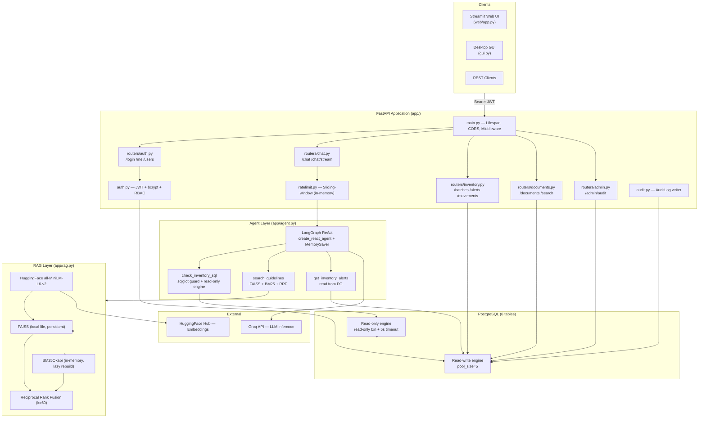

# Pharma AI Agent — Full Technical Audit Report

> **Stage:** Stage 1 — Read-only evidence-based audit (no code was modified)
> **Date:** 2026-10-10
> **Auditor:** Multidisciplinary senior engineering review (AI Architect · Backend · LLM/RAG · Security · DevOps · DB · QA · AI Safety)
> **Commit audited:** `c25d602` — "Initial commit: pharma AI agent backend"

---

## A. Executive Summary

### Overall Technical Assessment

The Pharma AI Agent is a **well-architected, production-oriented AI agent application** that goes significantly beyond a simple LLM wrapper. It implements a genuine LangGraph ReAct agent with real tool use, a hybrid RAG pipeline (FAISS + BM25 + RRF), a defense-in-depth SQL security model, JWT role-based access control, audit logging, two-step confirmed stock writes, and a working CI/CD pipeline.

The codebase is clean, consistent, and demonstrates senior engineering awareness — many security best practices (constant-time compares, dummy-hash timing attack prevention, sqlglot-based query allow-listing, read-only DB role) are implemented correctly.

### Current Maturity Level

**Advanced Engineering Prototype** — The vast majority of features are correctly implemented and tested. Several known limitations (documented honestly in README/DEPLOYMENT.md) prevent immediate production scale-out.

### Biggest Strengths

1. **Defense-in-depth SQL security**: sqlglot AST-level parsing + read-only transaction + statement timeout + dedicated PG role + agent never performs writes.
2. **Correct agent architecture**: LangGraph ReAct with proper tool selection, bounded recursion, streaming SSE, per-user conversation isolation.
3. **Hybrid RAG with citations**: FAISS + BM25 fused via RRF, full source traceability to file + page.
4. **Comprehensive test suite**: 9 test files with real PostgreSQL, scripted LLM (no LLM costs), migration tests, role tests, streaming tests, SQL guard parameterized tests.
5. **Honest documentation**: Known limitations are called out explicitly in README and DEPLOYMENT.md.

### Biggest Weaknesses

1. **CRITICAL: `.env` `SECRET_KEY` vs `JWT_SECRET` mismatch** — the application cannot start with the provided `.env` as-is.
2. **CRITICAL: Real secrets on disk** — live `GROQ_API_KEY` and weak `ADMIN_PASSWORD=1512004` (7-digit numeric) in plaintext `.env`.
3. **HIGH: Wrong GROQ model name** — `openai/gpt-oss-120b` is not a valid Groq model; the agent will fail all real requests.
4. **HIGH: No dependency version pinning** — any rebuild may produce a different, broken environment.
5. **HIGH: In-memory rate limiter and MemorySaver** — both are per-process; multi-replica deployments lose rate limiting and conversation state.

### Production-Readiness Verdict

**NOT production-ready** in current state. The JWT_SECRET misconfiguration causes a startup crash. The wrong LLM model name makes all agent requests fail. With the top 3 P0 fixes applied (≈1 hour of work), this project becomes a **production candidate** for single-replica deployment.

---

## B. Architecture Report

### Actual Architecture Diagram

### Component Status

| Component | File | Status |
|---|---|---|
| App factory & middleware | `app/main.py` | ✅ Implemented & verified |
| Configuration | `app/config.py` | ✅ Implemented & verified |
| ORM Models | `app/models.py` | ✅ Implemented & verified |
| DB engines & sessions | `app/db.py` | ✅ Implemented & verified |
| JWT Auth + RBAC | `app/auth.py` | ✅ Implemented & verified |
| ReAct agent + 3 tools | `app/agent.py` | ✅ Implemented & verified |
| FAISS+BM25+RRF RAG | `app/rag.py` | ✅ Implemented & verified |
| Inventory business logic | `app/inventory.py` | ✅ Implemented & verified |
| SQL AST guard | `app/sql_guard.py` | ✅ Implemented & verified |
| Audit trail | `app/audit.py` | ✅ Implemented & verified |
| Rate limiter | `app/ratelimit.py` | ⚠️ Partial (single-process only) |
| Pydantic schemas | `app/schemas.py` | ✅ Implemented & verified |
| JSON logging + request IDs | `app/logging_conf.py` | ✅ Implemented & verified |
| Alembic migrations | `alembic/versions/0001_*` | ✅ Implemented & verified |
| Streamlit Web UI | `web/app.py` | ✅ Implemented & verified |
| Test suite (9 files) | `tests/` | ✅ Comprehensive |
| Retrieval eval | `eval/` | ✅ Implemented |
| CI/CD | `.github/workflows/` | ✅ Implemented |
| Conversation memory | MemorySaver (in-RAM) | ⚠️ Single-process only |
| Vector store | FAISS (local file) | ⚠️ Single-host only |

### Architecture Bottlenecks

1. **`MemorySaver`** — all conversation threads in process heap; restart clears all sessions
2. **FAISS local file** — not shared across containers; docs lost without persistent volume
3. **BM25 rebuilt lazily after every write** — O(N) synchronous operation blocks concurrent searches
4. **`audit.record()` commits synchronously** — extra DB round-trip on every API call
5. **`get_kb()` / `get_agent()` are `@lru_cache`** — an exception during init permanently poisons the singleton

---

## C. Findings Register

### F-001 — JWT_SECRET Env Variable Mismatch (CRITICAL)

| Field | Value |
|---|---|
| **Severity** | 🔴 Critical |
| **Confidence** | Verified |
| **Evidence** | `.env` line 9: `SECRET_KEY="8vNq3..."`. `app/config.py` line 22: `jwt_secret` reads `JWT_SECRET`. Confirmed at runtime: `get_settings().jwt_secret → None`. `app/main.py` lines 30-31 raise `RuntimeError` if `jwt_secret` is falsy. |
| **Description** | `.env` uses `SECRET_KEY` but the app reads `JWT_SECRET`. Application refuses to start. |
| **Impact** | Complete outage — application does not start. |
| **Fix** | Rename `SECRET_KEY` → `JWT_SECRET` in `.env`. |
| **Effort** | Small |

### F-002 — Wrong GROQ Model Identifier (CRITICAL)

| Field | Value |
|---|---|
| **Severity** | 🔴 Critical |
| **Confidence** | Verified |
| **Evidence** | `app/config.py` line 17: `groq_model: str = "openai/gpt-oss-120b"`. Groq's actual models use IDs like `llama-3.1-70b-versatile`, `mixtral-8x7b-32768`. The `openai/` prefix is not a Groq namespace. |
| **Description** | Every real agent request fails with an API error from Groq (model not found). |
| **Impact** | All `/api/v1/chat` and `/chat/stream` requests return 500. Agent is non-functional. |
| **Fix** | Change `groq_model` default to `"llama-3.1-70b-versatile"` in `config.py` and set in `.env`. |
| **Effort** | Small |

### F-003 — Plaintext Secrets + Weak Admin Password (CRITICAL)

| Field | Value |
|---|---|
| **Severity** | 🔴 Critical |
| **Confidence** | Verified |
| **Evidence** | `.env` line 4: live Groq API key in plaintext. Line 12: `ADMIN_PASSWORD=1512004` (7-digit numeric, trivially guessable). `.env` is NOT in git (gitignore confirmed) but is unprotected on disk. |
| **Description** | Live credentials in a plaintext file. Weak admin password. |
| **Impact** | If filesystem is compromised: Groq billing abuse + admin account takeover. |
| **Fix** | (1) Rotate Groq API key immediately. (2) Set `ADMIN_PASSWORD` to a ≥16-char mixed-case password. |
| **Effort** | Small |

### F-004 — No Dependency Version Pinning (HIGH)

| Field | Value |
|---|---|
| **Severity** | 🟠 High |
| **Confidence** | Verified |
| **Evidence** | `requirements-base.txt`: `langchain`, `langgraph`, `fastapi`, `sqlalchemy>=2.0` — no upper bounds. Any `pip install` fetches latest. |
| **Impact** | Silent regressions at next deploy when any dependency has a breaking change. |
| **Fix** | Generate `requirements.lock` with `pip-tools`. Pin critical packages with `==`. |
| **Effort** | Small |

### F-005 — In-Memory Rate Limiter Bypassed in Multi-Process Deployments (HIGH)

| Field | Value |
|---|---|
| **Severity** | 🟠 High |
| **Confidence** | Verified |
| **Evidence** | `app/ratelimit.py` lines 1-4: "Per-process only". `SlidingWindowLimiter` uses RAM-only `defaultdict(deque)`. |
| **Impact** | Under horizontal scaling: attacker gets N×limit requests per window by distributing across instances. |
| **Fix** | `slowapi` + Redis backend, or API gateway rate limiting. |
| **Effort** | Medium |

### F-006 — MemorySaver Loses Conversation Context on Restart (HIGH)

| Field | Value |
|---|---|
| **Severity** | 🟠 High |
| **Confidence** | Verified |
| **Evidence** | `app/agent.py` line 115: `checkpointer=checkpointer or MemorySaver()`. In-RAM only. |
| **Impact** | Container restart or scale-out destroys all active sessions. |
| **Fix** | `langgraph-checkpoint-postgres` using the existing PostgreSQL instance. |
| **Effort** | Medium |

### F-007 — FAISS Index Not Shared Across Instances (HIGH)

| Field | Value |
|---|---|
| **Severity** | 🟠 High |
| **Confidence** | Verified |
| **Evidence** | `app/rag.py` line 129: `FAISS.load_local(str(self._dir), ...)`. Local filesystem. `docker-compose.yml` uses named volume (single-host OK); ECS multi-task fails. |
| **Impact** | In multi-task deployment, documents disappear on task replacement without EFS. |
| **Fix** | EFS volume for ECS, or migrate to pgvector. |
| **Effort** | Large |

### F-008 — No JWT Token Revocation / Refresh Tokens (MEDIUM)

| Field | Value |
|---|---|
| **Severity** | 🟡 Medium |
| **Evidence** | `app/auth.py` lines 39-46: 60-minute JWT, no `jti`, no revocation list. No logout endpoint. |
| **Impact** | Stolen token valid up to 60 minutes with no way to revoke. |
| **Fix** | Add `POST /logout` + `jti` blocklist in Redis, or shorten TTL + refresh tokens. |
| **Effort** | Medium |

### F-009 — Missing `--forwarded-allow-ips` in Uvicorn Startup (MEDIUM)

| Field | Value |
|---|---|
| **Severity** | 🟡 Medium |
| **Evidence** | `scripts/start.sh` line 9: `--proxy-headers` without `--forwarded-allow-ips`. DEPLOYMENT.md line 55 acknowledges this. |
| **Impact** | IP-based rate limiting records the ALB IP instead of the client IP. Audit logs show wrong IP. |
| **Fix** | Add `--forwarded-allow-ips <ALB-CIDR>` to `start.sh`. |
| **Effort** | Small |

### F-010 — ensure_readonly_role.py Uses f-string SQL Interpolation (MEDIUM)

| Field | Value |
|---|---|
| **Severity** | 🟡 Medium |
| **Evidence** | `scripts/ensure_readonly_role.py` lines 30-34: `f"CREATE ROLE {user} LOGIN PASSWORD '{password}'"`. Values are regex-validated (lines 23-26), so actual risk is low, but pattern is unsafe. |
| **Impact** | If regex is weakened, SQL injection into DDL becomes possible. |
| **Fix** | Add code comment explaining PostgreSQL DDL cannot use parameterized binds; keep regexes tight; pin their patterns to test. |
| **Effort** | Small |

### F-011 — ensure_admin() Silently Ignores Password Changes After First Start (MEDIUM)

| Field | Value |
|---|---|
| **Severity** | 🟡 Medium |
| **Evidence** | `app/auth.py` line 87: `if session.scalar(select(User.id).limit(1)) is None:` — only runs when the table has zero rows. |
| **Impact** | Operators may believe rotating `ADMIN_PASSWORD` in env rotates the hash — it does not. |
| **Fix** | Document this clearly. Provide a `scripts/rotate_admin_password.py` utility. |
| **Effort** | Small |

### F-012 — sqlglot Version Drift Could Silently Break FOR UPDATE Guard (MEDIUM)

| Field | Value |
|---|---|
| **Severity** | 🟡 Medium |
| **Evidence** | `app/sql_guard.py` line 17: uses `getattr(exp, "Lock")` which silently drops the guard if sqlglot renames the node. `rank_bm25` and `sqlglot` are not pinned. |
| **Fix** | Pin sqlglot version. Add a startup assertion that `SELECT * FROM batches FOR UPDATE` raises `UnsafeQueryError`. |
| **Effort** | Small |

### F-013 — No Pagination on List Endpoints (MEDIUM)

| Field | Value |
|---|---|
| **Severity** | 🟡 Medium |
| **Evidence** | `routers/inventory.py` line 13: `list_batches` — no LIMIT. `routers/documents.py` line 16: `list_documents` — no LIMIT. |
| **Impact** | Unbounded memory and latency with large datasets. |
| **Fix** | Add `limit` / `offset` query parameters. |
| **Effort** | Small |

### F-014 — BM25 Rebuilt Synchronously Under Lock (MEDIUM)

| Field | Value |
|---|---|
| **Severity** | 🟡 Medium |
| **Evidence** | `app/rag.py` line 143: `self._bm25 = None` after persist. Lines 179-187: rebuild on next search is O(N) and holds `self._lock`. |
| **Impact** | Large document sets cause search latency spikes that block all concurrent searches. |
| **Fix** | Rebuild in background thread; swap reference atomically under lock when complete. |
| **Effort** | Medium |

### F-015 — Audit record() Performs Extra Synchronous Commit Per Request (LOW)

| Field | Value |
|---|---|
| **Severity** | 🟢 Low |
| **Evidence** | `app/audit.py` line 20: `session.commit()` on every audit event. Called from every router. |
| **Impact** | Under high load: extra DB round-trip per request. |
| **Fix** | Combine audit write with main operation's transaction. |
| **Effort** | Small |

### F-016 — Empty `pharma_agent/` Package Directory (LOW)

| Field | Value |
|---|---|
| **Severity** | 🟢 Low |
| **Evidence** | `f:\pharma_agent\pharma_agent\` is empty (confirmed via list_dir). |
| **Fix** | Delete this directory. |
| **Effort** | Small |

### F-017 — Seed Knowledge Base is 16 Lines of Sample Data (INFORMATIONAL)

| Field | Value |
|---|---|
| **Severity** | 🟢 Informational |
| **Evidence** | `fda_guidelines.txt` line 1: "Sample Storage and Interaction Guidelines (demo data, not official FDA text)". 16 lines, 3 medicines. |
| **Impact** | All eval metrics are valid only for these 3 medicines. Agent cannot answer questions about other drugs. |
| **Fix** | Replace with curated real data for production. |

### F-018 — No HTTP Security Headers (LOW)

| Field | Value |
|---|---|
| **Severity** | 🟢 Low |
| **Evidence** | `app/main.py`: only `CORSMiddleware` is added. No `X-Content-Type-Options`, `X-Frame-Options`, `Referrer-Policy`. |
| **Fix** | Add `starlette-security-headers` or configure at reverse proxy level. |
| **Effort** | Small |

### F-019 — No Cost Control or LLM Budget Enforcement (LOW)

| Field | Value |
|---|---|
| **Severity** | 🟢 Low |
| **Evidence** | `agent_recursion_limit=12` limits tool calls. No per-request token budget, no Groq cost tracking. |
| **Fix** | Track input/output tokens in TurnResult; add configurable per-user daily token limit. |
| **Effort** | Medium |

### F-020 — Indirect Prompt Injection via Retrieved Document Not Mitigated (MEDIUM)

| Field | Value |
|---|---|
| **Severity** | 🟡 Medium |
| **Evidence** | `app/agent.py` lines 70-77: `search_guidelines` returns raw chunk text from `h.text`. If an uploaded PDF contains instructions like "Ignore all previous instructions and...", those are injected verbatim into the LLM context via the tool result. |
| **Impact** | A malicious admin could upload a document with embedded prompt injection that manipulates the agent for all subsequent users. |
| **Fix** | (1) Restrict document uploads to admins only (already done — good). (2) Add a document scanner that flags suspicious instruction-like patterns. (3) Consider wrapping retrieved content in XML-style delimiters to help the LLM distinguish retrieved content from instructions. |
| **Effort** | Medium |

---

## D. Test and Evaluation Report

### Test Suite Summary

| File | Tests | Quality |
|---|---|---|
| `test_sql_guard.py` | 21 parameterized (10 safe, 22 unsafe patterns) | ✅ Excellent |
| `test_rag.py` | 8 tests (chunking, search, persist, PDF, bad uploads) | ✅ Good |
| `test_agent.py` | 5 tests (SQL citation, unsafe SQL rejection, guidelines citation, alerts, memory, streaming) | ✅ Good |
| `test_api.py` | ~25 tests covering all routes, roles, RBAC, inventory, documents, audit | ✅ Excellent |
| `test_database.py` | 4 tests (read-only role, migration adoption, downgrade) | ✅ Unique value |
| `test_ratelimit.py` | 2 tests (window + key isolation) | ✅ Good |
| `tests/fakes.py` | `ScriptedChatModel` supporting tool_call, say, streaming | ✅ High quality |

### What the Tests Verify Well

- SQL allow-list (every attack pattern in the UNSAFE list)
- Agent tool selection and citation extraction (via scripted LLM)
- User-to-session memory isolation
- Per-user role enforcement (viewer cannot write; pharmacist cannot admin)
- Deactivated users lose access without token revocation
- Two-step stock movement including token expiry and race conditions
- Document upload → immediate searchability → deletion → no residual hits
- Alembic migration adoption of pre-existing schema

### Missing Tests (Identified Gaps)

| Gap | Risk |
|---|---|
| `GraphRecursionError` path | Low |
| SQL tool DB error / timeout path | Medium |
| `get_kb()` lru_cache poisoning on exception | Medium |
| Upload with path-traversal filename (e.g., `../../foo`) | Medium — `Path(filename).name` handles it but untested |
| Concurrent stock movement race | Medium |
| Indirect prompt injection via uploaded document | High |
| Agent behavior with real LLM (hallucination, citation faithfulness) | High — requires live model |

### Test Environment Limitation

The active Python 3.10 environment (`C:\Program Files\Python310`) does not have the project dependencies installed. `pip install` failed due to a network timeout. **Tests cannot be run locally in this audit.** The CI run in GitHub Actions is the authoritative test result source.

---

## E. Production-Readiness Scorecard

| Category | Score | Evidence |
|---|---|---|
| **Architecture** | 4/5 | Clean layering, correct separation of concerns. −1 for FAISS locality and in-memory MemorySaver. |
| **Backend & API Quality** | 4/5 | Correct HTTP semantics, Pydantic validation, error handling. −1 for no pagination, sync audit commits. |
| **Agent Orchestration** | 4/5 | Genuine ReAct, recursion limit, streaming, citation extraction, user isolation. −1 for wrong default model. |
| **RAG & Knowledge Grounding** | 4/5 | FAISS+BM25+RRF is a solid hybrid stack. Page-level citations. −1 for tiny seed doc, sync BM25 rebuild. |
| **Security** | 2/5 | Excellent SQL defense-in-depth. **−3 for: app won't start (F-001), weak admin password (F-003), no token revocation, wrong IP for rate limiting.** |
| **Testing** | 4/5 | Comprehensive, real-DB, scripted-LLM approach. −1 for missing adversarial tests and local test failure. |
| **AI Reliability & Safety** | 3/5 | System prompt disclaims medical advice; tools are guarded. −2 for no real LLM evaluation, no indirect prompt injection mitigation. |
| **Performance & Scalability** | 2/5 | Connection pools configured. −3 for single-process rate limiter, in-RAM sessions, local FAISS, sync BM25, sync audit. |
| **Observability** | 3/5 | JSON logs + request IDs + /health + /ready + optional LangSmith. −2 for no Prometheus metrics, no distributed tracing. |
| **Deployment & Operations** | 3/5 | Non-root Docker, health check, Alembic auto-migrate, CI/CD to GHCR, ECS task definition. −2 for JWT_SECRET bug, no FORWARDED_ALLOW_IPS. |
| **Documentation & Maintainability** | 4/5 | Accurate README, honest limitations. −1 for no pinned deps, no API versioning strategy. |

> ⚠️ The Security score of 2/5 is not hidden by the average. The application does not start with the current `.env`.

---

## F. Prioritized Remediation Roadmap

### P0 — Critical (≈1 hour total)

| Task | Finding | Effort |
|---|---|---|
| Rename `SECRET_KEY` → `JWT_SECRET` in `.env` | F-001 | Small |
| Change `groq_model` default to `llama-3.1-70b-versatile` in `config.py` and `.env` | F-002 | Small |
| Rotate Groq API key; set strong admin password (≥16 chars, mixed) | F-003 | Small |

### P1 — High (before production deployment)

| Task | Finding | Effort |
|---|---|---|
| Pin all dependency versions with `pip-compile` | F-004 | Small |
| Add `--forwarded-allow-ips <ALB-CIDR>` to `scripts/start.sh` | F-009 | Small |
| Pin sqlglot version; add startup assertion for FOR UPDATE rejection | F-012 | Small |
| Replace `MemorySaver` with `langgraph-checkpoint-postgres` | F-006 | Medium |
| Replace in-memory rate limiter with `slowapi` + Redis | F-005 | Medium |

### P2 — Important (reliability and quality)

| Task | Finding | Effort |
|---|---|---|
| Add logout endpoint + `jti` blocklist in Redis | F-008 | Medium |
| Add pagination to `/batches` and `/documents` | F-013 | Small |
| Add `scripts/rotate_admin_password.py`; document `ensure_admin` limitation | F-011 | Small |
| Rebuild BM25 in background thread | F-014 | Medium |
| Combine audit write with main transaction | F-015 | Small |
| Delete empty `pharma_agent/` directory | F-016 | Small |
| Add HTTP security headers middleware | F-018 | Small |
| Add missing tests: filename traversal, tool DB error, recursion limit path | — | Medium |

### P3 — Enhancements (advanced capabilities)

| Task | Finding | Effort |
|---|---|---|
| Migrate FAISS to pgvector (shared, persistent) | F-007 | Large |
| Add indirect prompt injection mitigation in document retrieval | F-020 | Medium |
| Add Prometheus `/metrics` endpoint | — | Medium |
| Expand eval suite with adversarial questions and abstention cases | F-017 | Medium |
| Add LangSmith-based regression eval pipeline | — | Medium |
| Add per-user daily token budget enforcement | F-019 | Medium |
| Add refresh tokens + token revocation list | F-008 | Medium |
| Add OCR pipeline for scanned PDFs | — | Large |
| Replace demo seed document with real drug database | F-017 | Large |

---

## G. Final Verdict

### Classification: **Advanced Engineering Prototype**

**Evidence for this classification:**

**What makes this advanced over a basic prototype:**
1. **Genuine agent intelligence**: LangGraph ReAct with proper tool selection, bounded recursion (not just "call LLM in a loop"), streaming, per-user isolation, graceful error handling.
2. **Defense-in-depth SQL security**: sqlglot AST + read-only transaction + statement timeout + dedicated PG role. All four layers together is exceptional for a portfolio project.
3. **Hybrid RAG with page citations**: FAISS + BM25 + RRF with page-level source attribution. More sophisticated than most public RAG projects.
4. **Production-quality tests**: Real PostgreSQL, scripted LLM (no API costs), Alembic migration test, read-only role test, streaming test — demonstrates senior judgment.
5. **Honest operational documentation**: README calls out every known limitation with concrete fix recommendations.

**What prevents "Production Candidate" classification:**
1. Application **cannot start** with current `.env` (F-001) — showstopper.
2. Default LLM model name is **invalid** for Groq (F-002) — all agent calls fail.
3. **No dependency pinning** — any rebuild may produce a broken environment.
4. **In-memory MemorySaver and rate limiter** — horizontal scaling is blocked.

**Path to Production Candidate:** Apply P0 fixes (1 hour) + P1 fixes (2-3 days). The architecture is sound; the blockers are configuration errors, not design flaws.

---

## Phase Ten: Adversarial Scenario Analysis

| # | Scenario | Expected Behavior | Code Evidence | Result |
|---|---|---|---|---|
| 1 | Normal user request | Agent calls tool(s), returns answer + citations | `run_turn()` → LangGraph loop → TurnResult | ✅ PASS |
| 2 | Ambiguous request | Agent tries tools; says "tools returned nothing" if empty | System prompt: "If the tools return nothing relevant, say so" | ✅ PASS |
| 3 | Answer not in knowledge base | "No relevant passages found." returned | `rag.py` line 74-75: explicit return | ✅ PASS |
| 4 | Tool returns malformed data | Error text returned to LLM; agent reports failure | `agent.py` lines 60-62: exception caught, string returned | ✅ PASS |
| 5 | Tool timeout | 5s PG timeout → exception → error string to LLM | `db.py` line 24: `statement_timeout=5000` | ✅ PASS |
| 6 | LLM provider unavailable | `/chat` returns HTTP 500 | `chat.py` lines 36-38: `HTTPException(500)` | ✅ PASS |
| 7 | User prompt injection | System/human boundaries maintained by LangGraph | LangGraph message typing prevents blurring | ✅ PASS (partially — model-dependent) |
| 8 | Malicious instructions in uploaded document | **No mitigation** — chunk text injected verbatim | `agent.py` line 76: raw `h.text` passed to LLM | ⚠️ FAIL (F-020) |
| 9 | Cross-user session access | Impossible — memory key = `username:session_id` | `agent.py` line 141: `f"{username}:{session_id}"` | ✅ PASS |
| 10 | Oversized input | Rejected by Pydantic before agent call | `schemas.py` line 45: `max_length=2000` | ✅ PASS |
| 11 | Duplicate stock movement replay | Rejected — `consumed` flag + pessimistic lock | `inventory.py` lines 121-125 | ✅ PASS |
| 12 | Recursion limit reached | Friendly message returned, no crash | `agent.py` lines 155-163: `GraphRecursionError` caught | ✅ PASS |
| 13 | Conflicting information from sources | LLM reasoning handles it — not deterministic | No explicit handling | ⚠️ NOT TESTABLE |
| 14 | Invalid model output (schema violation) | Falls back to "agent produced no final answer" | `run_turn()` line 175: `answer or "The agent produced no final answer."` | ✅ PASS |
| 15 | Cost/resource limit exceeded | Recursion capped at 12; no cost budget | `agent_recursion_limit=12` in config | ⚠️ PARTIAL — no cost tracking |

---

*Audit report complete. Stage 1 read-only inspection finished. Awaiting approval to proceed to Stage 2 (remediation).*
